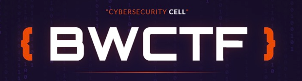
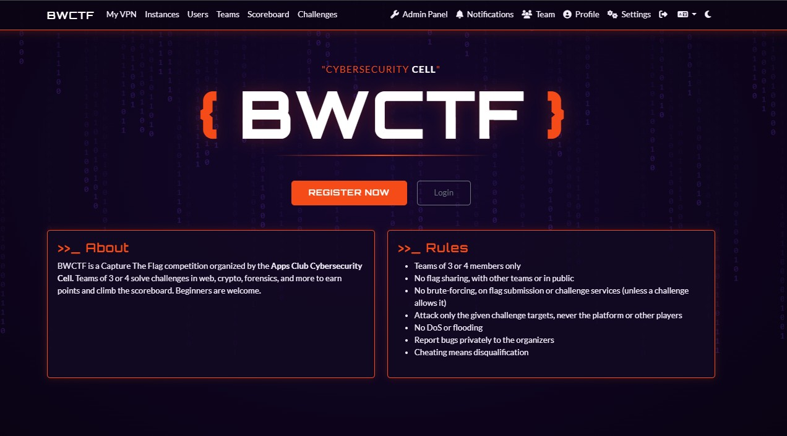
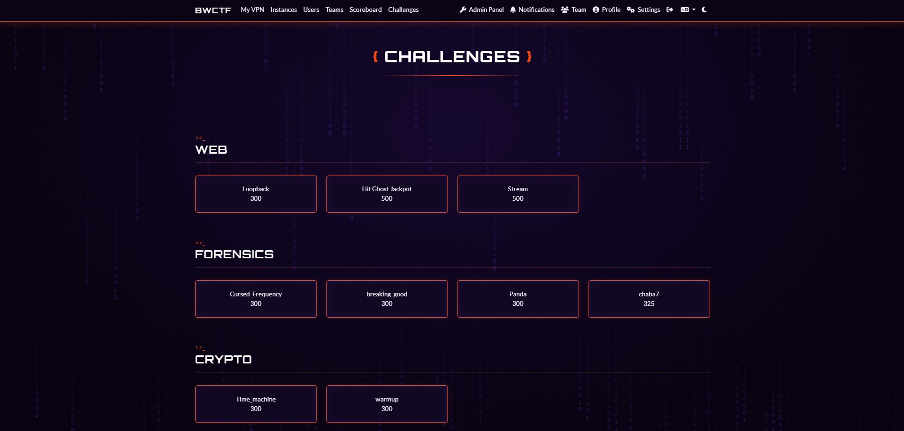
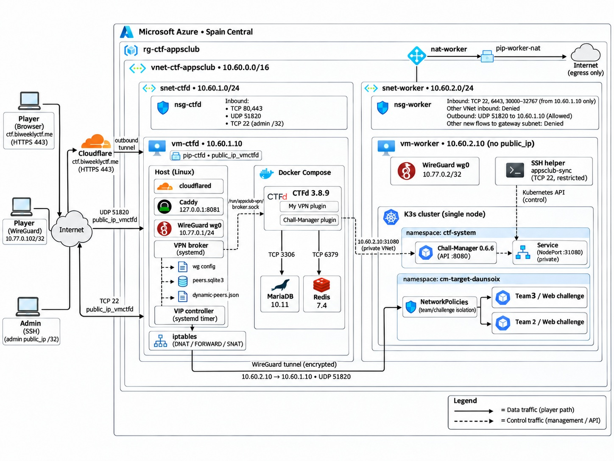
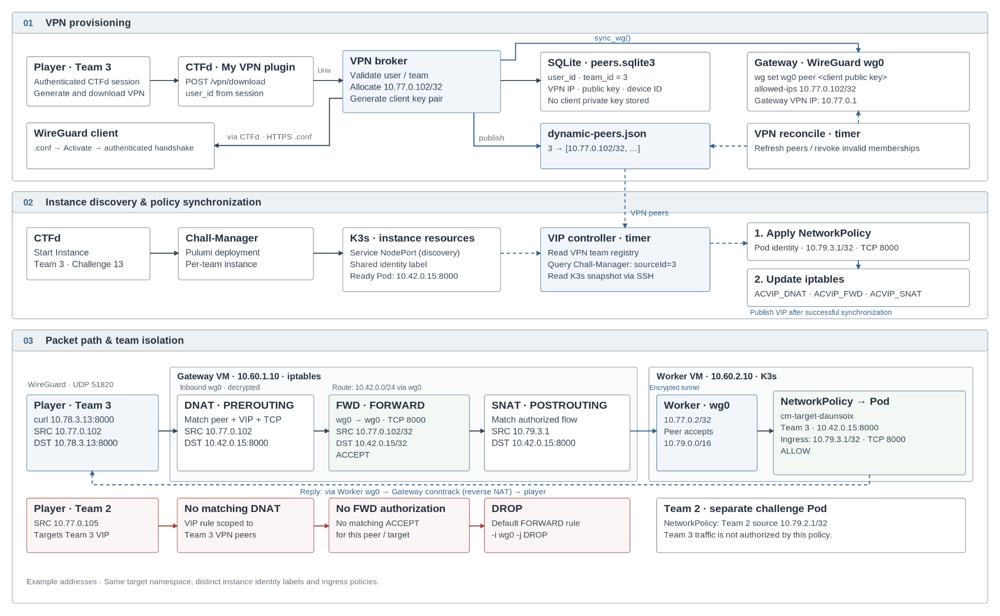

<p align="center">
  
</p>

<h1 align="center">BWCTF — Cloud CTF Platform</h1>

<p align="center">
  Infrastructure as Code for a team-based Capture The Flag competition,<br>
  built for the Apps Club Cybersecurity Cell and deployed on Microsoft Azure.
</p>

<p align="center">
  
  
  
  
  
  
  
</p>
<p align="center">
  
  
  
  
  
  
  
  
</p>

<p align="center">
  <a href="#platform-preview">Platform</a> ·
  <a href="#architecture">Architecture</a> ·
  <a href="#vpn-and-team-isolation">VPN &amp; isolation</a> ·
  <a href="#getting-started">Getting started</a> ·
  <a href="#documentation">Documentation</a>
</p>

## Overview

BWCTF combines CTFd's competition management with on-demand challenge environments. Rather than sharing a single vulnerable application across the competition, teams can start their own challenge instances in a private K3s cluster and access them through individual WireGuard VPN profiles.

The project focuses on infrastructure automation, dynamic instance provisioning and network isolation, using a two-VM Azure architecture and custom integrations around CTFd and Chall-Manager.

- **Infrastructure as Code:** Azure networking and virtual machines managed with Terraform; host configuration and services deployed with Ansible.
- **Dynamic challenges:** Chall-Manager and Go/Pulumi scenarios provision per-team Kubernetes instances and instance-specific flags.
- **Self-service VPN:** authenticated players generate and revoke individual WireGuard device profiles directly in CTFd.
- **Automated isolation:** a gateway-native VIP controller reconciles team-specific firewall rules and Kubernetes NetworkPolicies.
- **Private management plane:** a private Worker, restricted SSH automation and a non-public Chall-Manager API.

## Platform preview

<p align="center">
  
  <br><sub>Competition homepage</sub>
</p>

<p align="center">
  
  <br><sub>Challenge board — Web, Forensics and Crypto</sub>
</p>

## Architecture

<p align="center">
  
</p>

The platform separates competition services on the **Gateway VM** from challenge workloads on a **private Worker VM**, inside an Azure virtual network in Spain Central.

| Layer | Implementation |
| --- | --- |
| Azure network | VNet `10.60.0.0/16`, separate Gateway and Worker subnets, NSGs |
| Gateway — `10.60.1.10` | Caddy, WireGuard, VPN broker and VIP controller on the host; CTFd, MariaDB and Redis in Docker Compose |
| Worker — `10.60.2.10` | Single-node K3s, Chall-Manager, restricted SSH helper and challenge Pods; no direct public IP |
| Public web access | HTTPS through Cloudflare Tunnel in the event setup; local Caddy upstream to CTFd |
| Private challenge access | WireGuard over UDP 51820 and per-team virtual IPs; direct routing to Pod IPs |
| Worker Internet egress | Azure NAT Gateway with an associated public IP |

Cloudflare Tunnel was configured for the event deployment. The repository includes Caddy's loopback tunnel ingress on port `8081`; provisioning the tunnel and its credentials remains a separate deployment step.

## VPN and team isolation

<p align="center">
  
</p>

The custom **My VPN** plugin requests a profile from the gateway VPN broker over a protected Unix socket. The broker validates CTFd membership, allocates a device IP and registers the corresponding public key with WireGuard. The client's private key is delivered in its configuration file and is not retained in the broker database.

When a team launches an instance, the VIP controller discovers the associated Kubernetes Service and ready Pod through Chall-Manager and a restricted SSH helper. It applies the instance NetworkPolicy, installs gateway firewall rules, and publishes the validated VPN address for CTFd to display. Its periodic reconciliation also handles instance removal and VPN membership changes.

For a team member connecting to a challenge, the packet path is:

```text
Player VPN IP
    -> Challenge VIP (10.78.<team_id>.<challenge_id>:<app_port>)
    -> Gateway: DNAT -> routing decision -> FWD -> SNAT
    -> WireGuard tunnel to Worker
    -> Kubernetes NetworkPolicy -> Challenge Pod
```

| Network | Purpose |
| --- | --- |
| `10.77.0.0/24` | WireGuard peers; dynamic player devices use `.100`–`.254` |
| `10.78.0.0/16` | Team-specific challenge VIPs |
| `10.79.0.0/16` | Team source addresses after SNAT |
| `10.42.0.0/24` | Worker Pod network |

The NodePort is used for **instance discovery**, not as the player traffic destination. The gateway translates the VIP directly to the Pod IP and permits only the registered team peers and application TCP port. Kubernetes ingress policy provides a second team-scoped control. Example IPs and labels in the diagrams illustrate the design, rather than a live inventory of deployed instances.

Implementation: [VPN broker](ansible/files/appsclub_vpn_broker.py) · [VIP controller](ansible/files/appsclub_vip_controller.py) · [Kubernetes policy helper](ansible/files/appsclub_vip_k8s.py) · [VPN self-service guide](docs/VPN_SELFSERVICE_V3.md).

## Challenge scenarios

The repository contains four Go/Pulumi scenarios that package vulnerable Web applications into on-demand, single-Pod challenge environments.

| Scenario | Application port | Source |
| --- | ---: | --- |
| Loopback | 5000 | [challenges/loopback](challenges/loopback/) |
| Hit Ghost Jackpot | 5000 | [challenges/hit-ghost-jackpot](challenges/hit-ghost-jackpot/) |
| Stream | 8080 | [challenges/stream](challenges/stream/) |
| VibeChain Breach | 8000 | [challenges/vibechain-breach](challenges/vibechain-breach/) |

All four scenarios declare CPU requests of `50m` and memory requests of `64Mi`, with container limits of `500m` CPU and `256Mi` memory. The first three appear on the supplied event challenge-board screenshot; VibeChain is also included in the repository as a pilot scenario.

The current VIP connection-info adapter supports multiple non-shared HTTP challenge instances with validated mappings, instead of being hard-coded to VibeChain.

## Getting started

### Prerequisites

- Azure subscription and Azure CLI, Terraform, Ansible and SSH access (WSL/Linux recommended).
- Docker, Go and Pulumi for building or deploying challenge scenarios.
- Access to the customized Chall-Manager Git submodule and the required container/scenario registries.
- Local configuration and secrets, kept outside version control.

### Clone the repository

```bash
git clone --recurse-submodules git@github.com:Yasserkdr1/ctf-appsclub-infra.git
cd ctf-appsclub-infra
```

For an existing clone:

```bash
git submodule update --init --recursive
```

### Validate the source locally

These commands do not provision Azure resources. In a fresh Terraform checkout, initialize providers without configuring the remote backend:

```bash
python3 -m unittest discover -s tests -p 'test_*.py' -v

terraform -chdir=terraform/environments/test init -backend=false
terraform -chdir=terraform/environments/test validate

cp -n ansible/inventory.ini.example ansible/inventory.ini
for playbook in ansible/playbooks/*.yml; do
  ansible-playbook -i ansible/inventory.ini "$playbook" --syntax-check || break
done
```

Use the existing initialized backend instead if you already manage a deployed Terraform environment. The inventory uses the `ctf-gateway` and `ctf-worker` SSH aliases.

### Deploy to Azure

See the [backend bootstrap guide](terraform/bootstrap/README.md), [operations runbook](docs/operations.md) and [dependency inventory](docs/dependencies.md) before provisioning.

1. Create local Terraform settings from the example files under `terraform/environments/test/`, configure the Azure state backend and review the Terraform plan. VM provisioning is opt-in via `deploy_vms`.
2. Configure the local Ansible inventory, SSH access and required secret files. Install host dependencies, Docker, K3s and WireGuard using the relevant playbooks.
3. Bootstrap the Kubernetes security resources and deploy the pinned/custom Chall-Manager fork separately using its Pulumi deployment. The bootstrap playbook performs validation by default.
4. Configure the VIP controller and VPN self-service broker, deploy CTFd and Caddy, and configure Cloudflare Tunnel if using the event ingress design.
5. Publish and configure the challenge scenarios, enable the reviewed reconciliation services, then run connectivity and isolation smoke tests.

This is an overview, not an unattended installation script. Follow the runbooks for required variables, credentials, explicit enable/apply gates and deployment order. A clean deployment of every component from scratch has not yet been fully validated.

### Operational smoke checks

On an already deployed environment:

```bash
ssh ctf-gateway 'sudo docker ps --format "table {{.Names}}\t{{.Status}}"'
ssh ctf-gateway 'systemctl is-active caddy appsclub-vpn-broker.service appsclub-vip-sync.timer appsclub-vpn-reconcile.timer'
ssh ctf-worker 'sudo k3s kubectl get nodes'
ssh ctf-worker 'sudo k3s kubectl -n cm-target-daunsoix get pods,services,networkpolicies'
```

For a player-side test, use an authenticated test team, download its VPN profile, start an instance and send an HTTP request to the VIP displayed by CTFd. Confirm that the same team's registered devices can reach the instance, while a different team cannot.

## Repository structure

```text
.
├── terraform/                # Azure modules, remote state and environment
├── ansible/                  # Host setup and service deployment
│   ├── files/                # CTFd, K3s manifests and custom controllers
│   ├── playbooks/            # Installation and configuration tasks
│   └── templates/            # WireGuard, Caddy and systemd units
├── challenges/               # Web apps and Go/Pulumi scenarios
├── config/                   # Example VPN peer registries
├── external/chall-manager/   # Customized Chall-Manager submodule
├── scripts/                  # Operational and migration utilities
├── tests/                    # Python unit tests
└── docs/                     # Architecture, runbooks and visual assets
    └── assets/
        ├── brand/
        ├── diagrams/
        └── screenshots/
```

## Security and validation

The repository is designed around private challenge workloads, default-deny controls, per-device WireGuard authorization, narrowly scoped management access and team-specific VIPs. Automated tests cover VPN allocation and revocation, firewall/policy planning, dynamic ports, and fail-closed VIP publication/display.

- **Local validation:** 21 Python unit tests passed on the reviewed repository snapshot.
- **Functional validation:** Azure infrastructure, HTTPS ingress, VPN self-service, dynamic deployment and cross-team isolation have been exercised during development, as recorded in the project runbooks.
- **Remaining validation:** a fully reproducible fresh deployment, concurrent load testing, recovery exercises, and production security review.

Never publish live credentials, private keys, VPN profiles, Terraform state, challenge solutions or active flag seeds. Keep the Kubernetes API and Chall-Manager API private. Review the exposed services and the repository contents before opening registration or publishing the code.

## Documentation

| Document | Scope |
| --- | --- |
| [Architecture](docs/repository-architecture.md) | Repository and infrastructure design |
| [Operations](docs/operations.md) | Deployment and smoke checks |
| [Kubernetes bootstrap](docs/KUBERNETES_BOOTSTRAP.md) | Namespace, API and baseline policies |
| [VIP controller](docs/VIP_CONTROLLER_V2.md) | Instance discovery and network rule reconciliation |
| [VPN self-service](docs/VPN_SELFSERVICE_V3.md) | Device provisioning and revocation |
| [HTTPS and Caddy](docs/HTTPS_CADDY.md) | TLS and reverse proxy configuration |
| [Security review](docs/security-review.md) | Security considerations |
| [Dependencies](docs/dependencies.md) | Component versions and customized deployment |

Some runbooks describe earlier pilot deployments (including the temporary DNS endpoint and VIP display before generalization). Refer to the current source and review the runbook instructions before applying changes.

---

<p align="center">Built for the Apps Club Cybersecurity Cell — BWCTF.</p>
